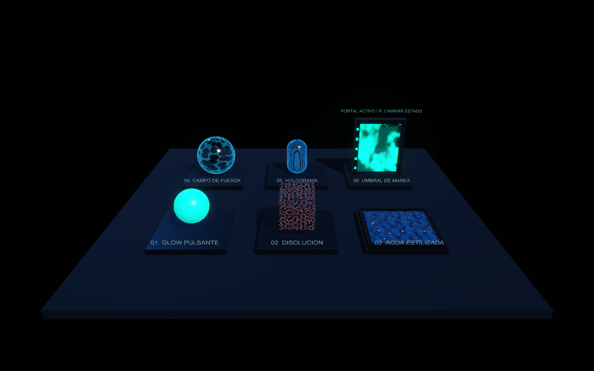

# Shader-Practica — Shander

Práctica de Shader Graph en **Unity 6.3 LTS (6000.3.22f1)** con **URP 17.3.0**.

## Abrir el proyecto

1. Clona este repositorio y agrega su carpeta desde Unity Hub.
2. Abre el proyecto con Unity **6000.3.22f1** y espera la importación de paquetes.
3. Abre `Assets/_MyShaders/Scenes/ShaderShowcase.unity` y pulsa **Play**.

| Nivel | Shaders |
|---|---|
| 1 · Aprendiz | Pulse Glow, Dissolve y Water |
| 2 · Artesano | Force Field y Hologram con glitch |
| 3 · Maestro | Tide Gate: Umbral de Marea, portal con teletransporte |

Todos los patrones son procedurales, sin paquetes de texturas externos. Los grafos, materiales, prefabs, scripts y escenas están en `Assets/_MyShaders`.

## Controles

**1–6:** primeros planos · **Tab:** galería · **WASD:** movimiento · **Q/E:** altura · **clic derecho:** mirar · **Shift:** velocidad · **R:** activar/desactivar el portal · **H:** mostrar/ocultar panel.

Para ver los nodos, abre un `.shadergraph` con doble clic y pulsa **A** con el cursor sobre el lienzo.

## Evidencias y explicación

- [Journal y explicación técnica](EntregaShaders/Journal.md).
- [Resultados de validación](EntregaShaders/Evidencias/Validacion.txt).
- [Diagramas exportados de los seis grafos](EntregaShaders/Evidencias/Grafos/).
- [GIF del material original para la Dev Kata](EntregaShaders/Evidencias/MaterialImposible_CristalDeMarea.gif).
- `EntregaShaders/index.html`: visor local de las evidencias; ábrelo en un navegador después de clonar.

La rama de trabajo de la práctica es **feature/Shaders**. Las carpetas generadas por Unity, como Library y Temp, están excluidas mediante `.gitignore`.

Los diagramas exportados no son capturas de la interfaz del editor. El GIF queda preparado para subirlo al foro; la publicación en el foro es una acción aparte.
